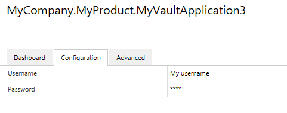

If you are not inheriting from `ConfigurableVaultApplicationBase<T>` then the below approach will not work.  The correct base class should automatically be used when creating new applications from the Visual Studio templates.
{:.note}

## Default configuration visibility

By default any configuration exposed using the VAF 2.1 base class will be **visible** to both vault administrators and system administrators, but will only be **editable** by system administrators.  Applications can change the default editing level by overriding `GetConfigurationManager()` and supplying the desired `defaultLevel` to `SecureConfigurationManager<T>`.
{:.note}

The `[Security]` attribute applies to configuration properties and fields, not configuration classes or vault application classes.


using MFiles.VAF.Configuration;
using MFiles.VAF.Core;

public class VaultApplication : ConfigurableVaultApplicationBase<Configuration>
{
	// Override the configuration manager creation to set the default
	// security level to VaultAdmin instead of SystemAdmin.
	protected override SecureConfigurationManager<Configuration> GetConfigurationManager()
	{
		return new SecureConfigurationManager<Configuration>(
			this.GetType().FullName,
			defaultLevel: SecurityAttribute.UserLevel.VaultAdmin);
	}
}


## Restricting who can view and change configuration elements

The `[Security]` attribute can also be used to configure who can change the value of a given element of the configuration.  This can be used to ensure that only system administrators - and not vault administrators - can change specific values.  **This is of increased importance in the M-Files cloud environment where some values must only be configurable by the M-Files Cloud Ops team.**

By default the configuration will be visible to vault administrators and system administrators, but only be editable by system administrators.  When running on the M-Files cloud this means that vault administrators can view, but not change, the configuration.
{:.note.warning}

In the following example the `WebAddress` property can only be changed by the System Administrator.  The value will be hidden from Vault Administrators in the `Configuration` tab, although they will see the value in the 'Advanced' configuration.  Vault Administrators will get an error when trying to save changes to the value.


using System.Runtime.Serialization;
using MFiles.VAF.Configuration;
using MFiles.VAF.Core;

namespace MyCompany.MyProduct.MyVaultApplication3
{
	public class VaultApplication
		: ConfigurableVaultApplicationBase<Configuration>
	{
	}
	
	[DataContract]
	public class Configuration
	{
		// The username and password are visible to, and editable by, vault administrators.
		[DataMember]
		[Security(ChangeBy = SecurityAttribute.UserLevel.VaultAdmin)]
		public string Username { get; set; }

		// Note that the password is marked as a password so will be shown as stars.
		[DataMember]
		[Security(IsPassword = true, ChangeBy = SecurityAttribute.UserLevel.VaultAdmin)]
		public string Password { get; set; }

		// This member can be seen by vault admins, but only changed by system admins.
		[DataMember]
		[Security(ViewBy =SecurityAttribute.UserLevel.VaultAdmin, ChangeBy = SecurityAttribute.UserLevel.SystemAdmin)]
		public bool Enabled { get; set; }

		// This member is not visible to vault administrators.
		[DataMember]
		[Security(ChangeBy = SecurityAttribute.UserLevel.SystemAdmin)]
		public string WebAddress { get; set; }
 
	}
}


## Nested configuration

- A property's `ChangeBy` setting also applies to members of its nested object or collection elements unless a nested member has its own `[Security]` attribute.
- A nested member's explicit `[Security]` replaces the inherited `ChangeBy` setting, allowing either stricter or less restrictive editing permissions.
- If no property or field along the containing path has `[Security]`, the configuration manager's default editing level applies.
- Only `ChangeBy` is inherited this way; `ViewBy` and `IsPassword` are not inherited.


using System.Runtime.Serialization;
using MFiles.VAF.Configuration;

[DataContract]
public class Configuration
{
	[DataMember]
	[Security(ChangeBy = SecurityAttribute.UserLevel.VaultAdmin)]
	public ConnectionSettings Connection { get; set; }
}

[DataContract]
public class ConnectionSettings
{
	// Inherits VaultAdmin editing permission from Connection.
	[DataMember]
	public string Username { get; set; }

	// Overrides the inherited permission: only system admins can edit.
	[DataMember]
	[Security(ChangeBy = SecurityAttribute.UserLevel.SystemAdmin)]
	public string ServerAddress { get; set; }
}


An explicit attribute defaults `ChangeBy` to `SystemAdmin`, so `[Security(IsPassword = true)]` does not preserve an inherited `VaultAdmin` editing permission.  Specify `ChangeBy` explicitly to preserve it, for example `[Security(IsPassword = true, ChangeBy = SecurityAttribute.UserLevel.VaultAdmin)]`.
{:.note.warning}

Adding or removing an entire nested object is also checked against the containing property's permission, even when individual members allow less restrictive editing.

## Passwords within configuration elements

Passwords within configuration objects should be marked with the `[Security(IsPassword = true)]` attribute.  When this attribute is used, values displayed in the M-Files Admin software will be obscured and displayed insead as asterisks:


using System.Runtime.Serialization;
using MFiles.VAF.Configuration;
using MFiles.VAF.Core;

namespace MyCompany.MyProduct.MyVaultApplication3
{
	public class VaultApplication
		: ConfigurableVaultApplicationBase<Configuration>
	{
	}
	
	[DataContract]
	public class Configuration
	{
		[DataMember]
		public string Username { get; set; }

		[DataMember]
		[Security(IsPassword = true)]
		public string Password { get; set; }
 
	}
}


Note that configuration elements marked with a `[Security(IsPassword = true)]` attribute are not encrypted before being stored within Name Value Storage.  Whilst the storage location is only accessible to system administrators, it is important to note that these may be accessible by code executing with elevated rights.
{:.note.warning}